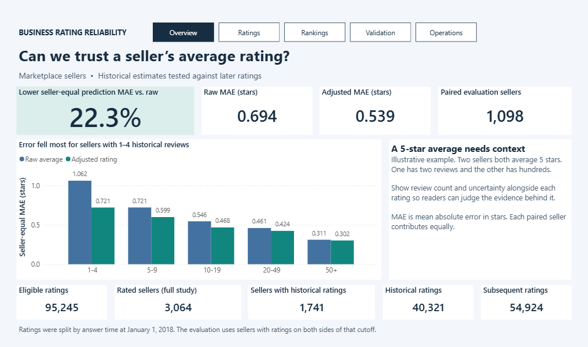

# Business Rating Reliability & Decision Intelligence

**Can we trust marketplace seller ratings when sellers have very different numbers of reviews?**

Review-volume-aware estimates reduced historical holdout prediction MAE by **22.3%**, from **0.694 to 0.539 stars**, across **1,098 paired sellers**. The absolute improvement was **0.155 stars** with a **95% paired bootstrap interval of 0.124–0.186**.

**[View the live interactive case study](https://danielzhao0422.github.io/business-rating-reliability/)**

[Visual case study source](docs/index.html) · [Local preview instructions](docs/reproducibility.md#preview-the-case-study) · [Methodology](docs/methodology.md)

## Why it matters

Previous work evaluating businesses and customer reviews inspired this independent project. In an illustrative example, two sellers both average five stars. One has two reviews and the other has 500. Review counts help explain how much evidence supports each rating.

*Actual Power BI Desktop Overview. The interactive report stays local.*

## Findings

| Question | Corrected result |
| --- | --- |
| Where did adjustment help most? | Sellers with 1–4 historical reviews saw a **32.1%** lower MAE, from 1.062 to 0.721 stars. |
| How stable were ranks? | **816** paired sellers shared a raw rating, the largest tie included **142**, and mean absolute movement was about **144 places**. Feasible overlap was 0–0 for Top 10 and 0–1 for Top 25 and Top 50. |
| Did predictive intervals cover later means? | Observed coverage was **92.7%** against a 95% target, and **85.6%** for sellers with at least 50 historical reviews. |
| Could ratings substitute for fulfillment measures? | Spearman correlations with later lateness were **−0.084 raw** and **−0.042 adjusted** across 1,034 sellers. These are weak observational associations. |

## How I evaluated it

From Olist’s nine-file relational archive, I used DuckDB and SQL to isolate **95,245 eligible ratings** across **3,064 sellers**. Reviews were attributed only to unambiguous single-seller orders. Python estimated a review-volume-aware average by blending the raw seller mean with a pooled historical reference. Two expanding 2017 validation folds selected strength **20** before the January 1, 2018 holdout. The [answer-time correction](docs/temporal_availability_amendment.md) prevents scores submitted later from entering historical estimates. Each paired seller contributed equally to MAE.

Show counts and uncertainty alongside ratings, treat exact ranks with caution, and track fulfillment directly. The findings describe one historical marketplace and a paired seller cohort. Later observed ratings are noisy, intervals undercovered, and commercial impact was outside the evaluation.

## Repository map

- [SQL transformations](sql/olist/) and [Python research implementation](src/rating_reliability/) cover attribution, temporal evaluation and robustness.
- [Power BI generation](src/rating_reliability/powerbi_project.py) and the [model contract](docs/powerbi_data_model.md) cover Power Query imports, DAX, and five native report pages.
- [Research protocol](config/statistical_protocol.toml), [synthetic tests](tests/), and the [reproduction guide](docs/reproducibility.md) support technical review. Use Python 3.12 or 3.13 with `python -m pip install -e ".[dev]"` in a virtual environment.

Data source · [Brazilian E-Commerce Public Dataset by Olist](https://www.kaggle.com/datasets/olistbr/brazilian-ecommerce), listed under [CC BY-NC-SA 4.0](https://creativecommons.org/licenses/by-nc-sa/4.0/). See [data credit and terms](docs/data_attribution.md) for the content boundary and separate original software terms.
