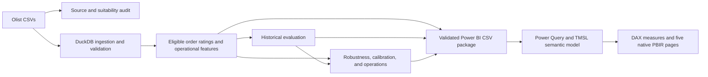

# Technical architecture

The study runs locally from a source checkout. Python module commands join the
CSV audit, DuckDB preparation, locked experiments, and Power BI export workflow.
Power BI Desktop consumes the validated export package on Windows.

| Component | Implementation and outputs |
|---|---|
| Source and quality audit | `olist_audit` inventories the Olist archive, profiles key integrity, seller attribution, rating coverage, and temporal feasibility, and writes local JSON, CSV, Markdown, and figures. The [reproduction guide](reproducibility.md#source-data) lists the nine files and the five required by preparation. |
| DuckDB preparation | `olist_prepare` loads the selected CSV fields as text and applies ordered [SQL transformations](../sql/olist). The database retains validation flags and a deterministic primary exclusion reason, one row per eligible order rating, operational features, category links, historical views, and persistent quality checks. It retains source keys for internal joins and excludes review text, customer IDs, payment details, and raw geolocation. See [analytical integration](olist_integration.md). |
| Historical evaluation | `statistical_analysis` follows the [locked protocol](../config/statistical_protocol.toml), tunes the prior before the cutoff, and compares raw and adjusted estimates on paired sellers. Outputs include prior-tuning, error, ranking, and uncertainty reports with provenance. |
| Robustness and operations | `phase3c_analysis` checks the Phase 3B source fingerprints. It adds sensitivity grids, tie-aware rank diagnostics, predictive calibration, and forward delivery analysis with explicit availability and lateness rules. See the [Phase 3C methodology](phase3c_methodology.md). |
| Power BI exports | `powerbi_export` combines DuckDB and the research artifacts, creates HMAC seller keys, and validates the [export contract](../config/powerbi_export_spec.toml), relationships, statistics, and privacy. The local package records per-CSV SHA-256 and research source fingerprints. |
| Semantic model | `powerbi_project` checks the package and generates a TMSL model. Fifteen typed Power Query imports resolve through `ExportRoot`. Six active one-to-many relationships filter in one direction. Fixed study and other aggregate tables use disconnected contexts as specified. DAX in `powerbi_measures` handles fixed, subgroup, and diagnostic measures. See the [model contract](powerbi_data_model.md) and [DAX implementation](../src/rating_reliability/powerbi_measures.py). |
| Report definitions | `powerbi_pages` and `powerbi_project` generate a PBIP pointer, five native enhanced PBIR pages, a theme, and `Validation.dax`. The populated project, cache and runtime evidence stay local. See the [Power BI implementation guide](powerbi_import_guide.md). |

The earlier synthetic business/review JSONL pipeline is a separate entry point
in `ingest`, with canonical SQL under `sql/analysis/`. Its
[fixtures](../data/sample/README.md)
exercise ingestion independently of Olist. See the
[reproduction guide](reproducibility.md) for execution and the
[data credit and terms](data_attribution.md) for the publication boundary.
