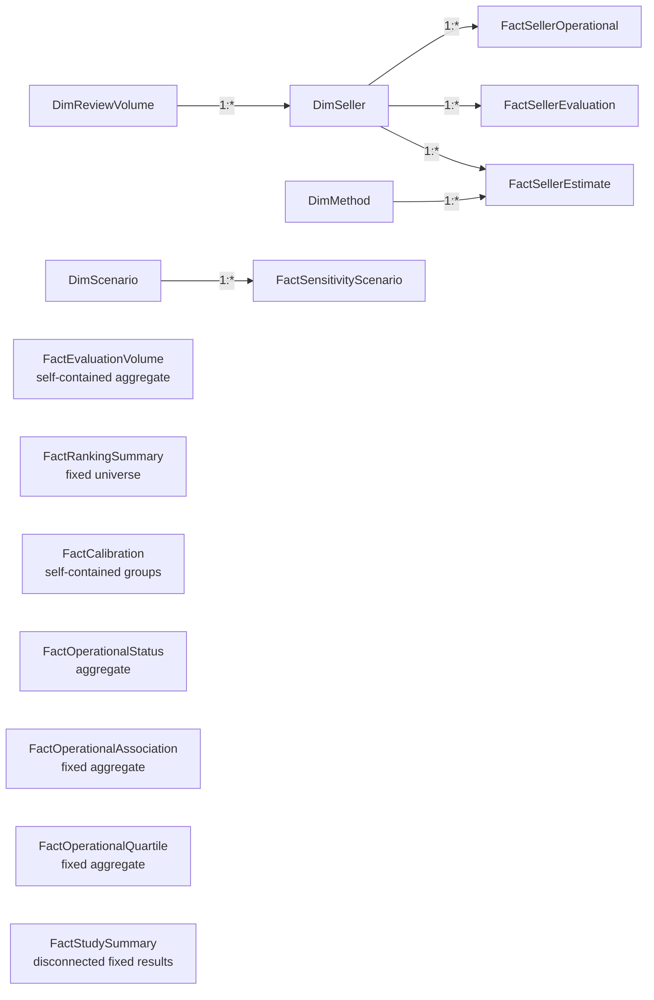

# Power BI Data Model and Export Contract

## Implemented model

The [export contract](../config/powerbi_export_spec.toml)
defines its column order, types, nullability, keys, and relationships. The
project builder consumes the validated exports and generates a Desktop
semantic model. The [Power BI implementation guide](powerbi_import_guide.md) records
model and DAX reconciliation against DuckDB and the Phase 3B/3C artifacts.

Curated CSV is the default because Power BI Desktop imports it without a custom
DuckDB connector. Every real-data export will remain under the ignored
`reports/local/powerbi/` boundary. UTF-8 with BOM makes labels reliable in
Power BI Desktop; comma delimiter, invariant decimal points, ISO dates, and
blank nulls keep Power Query typing explicit.

Export files and config identifiers use `snake_case`; Power Query renames final
loaded tables to PascalCase (`dim_seller` becomes `DimSeller`, for example).
Column names remain `snake_case`. The DAX examples use the PascalCase table
names and those exact column names.

## Model overview

The six arrows show active, single-direction filters from the one side to the
many side. Review Volume reaches the three seller facts through Seller. Method
reaches Seller Estimate only, and Scenario reaches Sensitivity only. No table pair
has multiple filter paths. Fixed study and standalone aggregate tables are
disconnected to preserve their denominators.

## Dimensions

### `dim_method.csv`

Grain: one row per rating method; two rows (`raw`, `adjusted`).

| Column | Type | Rule |
|---|---|---|
| `method_key` | text, PK | Stable lowercase key |
| `method_label` | text | Raw average / Adjusted rating |
| `method_order` | whole number | Raw=1, adjusted=2 |
| `method_description` | text | Plain-language definition |
| `color_hex` | text | Locked design-system color |

### `dim_review_volume.csv`

Grain: one row per locked historical volume band.

| Column | Type | Rule |
|---|---|---|
| `volume_group_key` | text, PK | `1-4`, `5-9`, `10-19`, `20-49`, `50+` |
| `lower_bound` | whole number | Inclusive |
| `upper_bound` | whole number, nullable | Inclusive; blank for 50+ |
| `sort_order` | whole number | 1 through 5 |
| `display_label` | text | User-facing band |

### `dim_scenario.csv`

Grain: one row per exported sensitivity scenario.

| Column | Type | Rule |
|---|---|---|
| `scenario_key` | text, PK | Existing Phase 3C scenario ID |
| `scenario_family` | text | Prior, reference, historical count, future count, cutoff, variability |
| `scenario_label` | text | Concise display label |
| `classification` | text | Locked primary, preplanned sensitivity, exploratory |
| `is_primary` | Boolean | True only for locked primary representation |
| `is_prespecified_summary` | Boolean | Alternative-cutoff summary flag |
| `cutoff` | date, nullable | Scenario cutoff |
| `sort_order` | whole number | Stable display order |
| `interpretation_note` | text | Difference from primary design |

### `dim_seller.csv`

Grain: one row per seller with at least one historical rating. This is broader
than the 1,098-seller evaluation cohort.

| Column | Type | Rule |
|---|---|---|
| `seller_key` | text, PK | 32-hex HMAC surrogate; source seller ID never exported |
| `seller_label` | text | `Seller ` plus a short nonidentifying display suffix |
| `historical_review_count` | whole number | Pre-2018 ratings only |
| `volume_group_key` | text, FK | Locked historical band |
| `has_evaluation_rating` | Boolean | Retrospective availability flag |
| `has_forward_operational_order` | Boolean | Forward cohort availability |

The HMAC secret comes from local environment variable
`POWERBI_SELLER_KEY_SECRET`, is never written to Git, and must remain unchanged
for stable refresh joins. A hash is a local pseudonym, not a release permission.

## Seller facts

### `fact_seller_estimate.csv`

Grain: one row per historical seller per method. Primary key
(`seller_key`, `method_key`).

| Column | Type | Meaning |
|---|---|---|
| `seller_key` | text, FK | Pseudonymized seller |
| `method_key` | text, FK | Raw or adjusted |
| `estimate` | decimal | Historical point estimate |
| `reference_mean` | decimal, nullable | Populated for adjusted method |
| `prior_strength` | decimal, nullable | Primary selected m for adjusted method |
| `adjustment_signed` | decimal | Adjusted minus raw; repeated consistently for the pair |
| `adjustment_absolute` | decimal | Absolute adjustment |
| `expected_rating_interval_lower` | decimal, nullable | Adjusted-model credible interval only |
| `expected_rating_interval_upper` | decimal, nullable | Adjusted-model credible interval only |
| `average_rank` | decimal | Tie-aware rank within declared ranking universe |
| `top_10_probability` | decimal, nullable | Model-conditional posterior inclusion |
| `top_25_probability` | decimal, nullable | Model-conditional posterior inclusion |
| `top_50_probability` | decimal, nullable | Model-conditional posterior inclusion |
| `ranking_universe` | text | Historical or primary evaluation universe |

The credible interval applies to the adjusted model. The exporter recomputes
seller-level posterior fields using the existing statistical functions, since
the aggregate research artifacts contain summaries only.
Rank and top-K fields are populated only for sellers in the primary evaluation
universe and remain blank for historical-only sellers; their universe label is
therefore explicit.

### `fact_seller_evaluation.csv`

Grain: one row per seller in the locked primary evaluation cohort; 1,098 rows
expected for the verified database. Primary/foreign key `seller_key`.

| Column | Type | Meaning |
|---|---|---|
| `seller_key` | text, PK/FK | Pseudonymized seller |
| `evaluation_review_count` | whole number | Later rating count |
| `evaluation_mean_rating` | decimal | Later seller mean |
| `raw_estimate` / `adjusted_estimate` | decimal | Fixed historical predictions |
| `raw_error` / `adjusted_error` | decimal | Estimate minus later mean |
| `raw_absolute_error` / `adjusted_absolute_error` | decimal | Seller-level absolute error |
| `raw_squared_error` / `adjusted_squared_error` | decimal | Seller-level squared error |
| `predictive_interval_lower` / `predictive_interval_upper` | decimal | Conditional on realized later count |
| `predictive_covered` | Boolean | Later mean inside interval |
| `predictive_miss_direction` | text | Below, inside, or above |

This paired wide layout is deliberate: `AVERAGEX` can compare both methods over
exactly the same filtered sellers without a method-dependent population.

### `fact_seller_operational.csv`

Grain: one row per historical seller with at least one forward operational
cohort order. Primary/foreign key `seller_key`. No order identifier is exported.

| Column | Type | Meaning |
|---|---|---|
| `seller_key` | text, PK/FK | Pseudonymized seller |
| `forward_order_count` | whole number | All eligible future-cohort orders |
| `delivered_order_count` | whole number | Status delivered |
| `evaluable_delivery_count` | whole number | Both timestamps present |
| `late_delivery_count` | whole number | Timestamp-level late among evaluable |
| `late_delivery_rate` | decimal, nullable | Late/evaluable for seller |
| `mean_delivery_delay_days` | decimal, nullable | Evaluable delivery mean |
| `mean_item_value` / `mean_freight_value` | decimal, nullable | Order-level means |

Aggregating before export prevents product-category or item joins from
duplicating orders. Raw and adjusted scores are reached through `DimSeller`, not
duplicated here.

## Aggregate and fixed-study facts

### `fact_evaluation_volume.csv`

One row per (`group_basis`, `volume_group_key`) from Phase 3B
`evaluation_by_volume.csv`. It contains seller/rating counts and raw/adjusted
MAE, RMSE, and review-weighted metrics. It is disconnected: these are completed
subgroup results, not additive facts. Visuals filter `group_basis` explicitly.

### `fact_ranking_summary.csv`

One row per K=10, 25, 50. Columns include deterministic overlap, minimum and
maximum tie-aware overlap, fractional expected overlap, boundary tie candidates,
Spearman, Kendall tau-b, mean absolute rank change, seller universe, and the
posterior pair-support summaries. It is fixed to the 1,098-seller universe and
ignores seller slicers.

### `fact_sensitivity_scenario.csv`

One row per scenario, keyed to `DimScenario`. Columns retain raw and adjusted
MAE/RMSE, absolute and relative improvement, seller and rating counts, retained
proportion, reference mean, prior strength, cutoff, and bootstrap bounds when
available. Pre-aggregated percentages and MAEs are never summed or averaged.

### `fact_calibration.csv`

One row per (`calibration_dimension`, `calibration_group`). Columns include
seller units, coverage, mean/median width, below/inside/above counts, nominal
coverage, and draw count. It remains disconnected because historical-volume,
evaluation-volume, variability, time, and prior-strength groups have different
denominators. Phase 4B prepends one `overall` / `all_evaluation_sellers` row from
`calibration_summary.json` to the 24 diagnostic CSV rows.

### `fact_operational_status.csv`

One row per fulfillment status in the forward cohort, with order count and
proportion. This supports a compact status bar and cannot be cross-filtered as
if it were seller-level data.

### `fact_operational_association.csv`

One row per (`method_key`, `outcome_key`) for seller-level correlations.
Columns include Pearson, Spearman, Spearman bootstrap bounds, seller count,
order count, and exploratory/noncausal classification. It is disconnected so a
seller slicer cannot distort a precomputed correlation.

### `fact_operational_quartile.csv`

One row per (`method_key`, `quartile_key`) with predictor boundaries, seller and
order counts, late orders, order-weighted late rate, and mean seller late rate.
It is a fixed exploratory summary and is not joined to `DimSeller`.

### `fact_study_summary.csv`

One row per fixed metric with `metric_key`, `metric_label`, `metric_value`,
`unit`, `population_label`, `classification`, `source_artifact`, and
`display_format`. It is deliberately disconnected and is used only for the 12
core population/model-comparison metrics: eligible, historical, and evaluation
rating counts; rated and evaluation seller counts; selected prior strength;
raw/adjusted MAE; absolute/relative improvement; and bootstrap lower/upper
bounds. Ranking, calibration, and operational fixed values remain in their
domain facts to avoid a second copy.

## Relationship contract

| From | To | Cardinality | Direction | Validation |
|---|---|---|---|---|
| DimReviewVolume | DimSeller | 1:* | Single | Every seller maps to exactly one band |
| DimSeller | FactSellerEstimate | 1:* | Single | Exactly two methods per exported seller |
| DimMethod | FactSellerEstimate | 1:* | Single | Only raw/adjusted keys |
| DimSeller | FactSellerEvaluation | 1:* | Single | No duplicate evaluation seller |
| DimSeller | FactSellerOperational | 1:* | Single | No duplicate operational seller |
| DimScenario | FactSensitivityScenario | 1:* | Single | Scenario sets identical |

The original contract paired one-to-one cardinality with Single filtering for
Evaluation, Operational, and Sensitivity. Power BI requires Both for 1:1 and
allows Single for 1:* with unique parent keys. A key on the many side can still be
unique. The Evaluation and Operational facts each have at most one row per
seller, and Sensitivity has exactly one row per scenario. Their primary keys
enforce those grains independently of model cardinality.
[Microsoft relationship documentation](https://learn.microsoft.com/en-us/power-bi/transform-model/desktop-relationships-understand)

Seller selections propagate to descriptive, evaluation, and operational facts;
they do not propagate to fixed ranking, sensitivity, calibration, status, or
study-summary tables.

## Exact export column inventory

The CSV columns below are governed by the executable
[export specification](../config/powerbi_export_spec.toml).

| File | Ordered analytical columns |
|---|---|
| `dim_method.csv` | `method_key`, `method_label`, `method_order`, `method_description`, `color_hex` |
| `dim_review_volume.csv` | `volume_group_key`, `lower_bound`, `upper_bound`, `sort_order`, `display_label` |
| `dim_scenario.csv` | `scenario_key`, `scenario_family`, `scenario_label`, `classification`, `is_primary`, `is_prespecified_summary`, `cutoff`, `sort_order`, `interpretation_note` |
| `dim_seller.csv` | `seller_key`, `seller_label`, `historical_review_count`, `volume_group_key`, `has_evaluation_rating`, `has_forward_operational_order` |
| `fact_seller_estimate.csv` | `seller_key`, `method_key`, `estimate`, `reference_mean`, `prior_strength`, `adjustment_signed`, `adjustment_absolute`, `expected_rating_interval_lower`, `expected_rating_interval_upper`, `average_rank`, `top_10_probability`, `top_25_probability`, `top_50_probability`, `ranking_universe` |
| `fact_seller_evaluation.csv` | `seller_key`, `evaluation_review_count`, `evaluation_mean_rating`, `raw_estimate`, `adjusted_estimate`, `raw_error`, `adjusted_error`, `raw_absolute_error`, `adjusted_absolute_error`, `raw_squared_error`, `adjusted_squared_error`, `predictive_interval_lower`, `predictive_interval_upper`, `predictive_covered`, `predictive_miss_direction` |
| `fact_evaluation_volume.csv` | `group_basis`, `volume_group_key`, `seller_count`, `historical_rating_count`, `evaluation_rating_count`, `raw_mae`, `adjusted_mae`, `mae_improvement`, `raw_rmse`, `adjusted_rmse`, `raw_review_weighted_mae`, `adjusted_review_weighted_mae`, `raw_review_weighted_rmse`, `adjusted_review_weighted_rmse` |
| `fact_ranking_summary.csv` | `top_k`, `seller_universe`, `spearman`, `kendall_tau_b`, `mean_absolute_rank_change`, `deterministic_overlap_count`, `minimum_overlap_count`, `maximum_overlap_count`, `fractional_overlap_count`, `boundary_tie_candidates`, `sampled_pairs`, `posterior_draws`, `strong_ordering_support_90` |
| `fact_sensitivity_scenario.csv` | `scenario_key`, `seller_count`, `historical_rating_count`, `evaluation_rating_count`, `retained_proportion`, `cutoff`, `prior_strength`, `reference_mean`, `raw_mae`, `adjusted_mae`, `mae_improvement`, `relative_mae_improvement`, `raw_rmse`, `adjusted_rmse`, `bootstrap_lower`, `bootstrap_upper`, `direction` |
| `fact_calibration.csv` | `calibration_dimension`, `calibration_group`, `seller_units`, `coverage`, `coverage_standard_error`, `mean_width`, `median_width`, `below_count`, `inside_count`, `above_count`, `nominal_coverage`, `draws`, `note` |
| `fact_seller_operational.csv` | `seller_key`, `forward_order_count`, `delivered_order_count`, `evaluable_delivery_count`, `late_delivery_count`, `late_delivery_rate`, `mean_delivery_delay_days`, `mean_item_value`, `mean_freight_value` |
| `fact_operational_status.csv` | `order_status`, `order_count`, `order_proportion` |
| `fact_operational_association.csv` | `method_key`, `outcome_key`, `seller_count`, `order_count`, `pearson`, `spearman`, `spearman_ci_lower`, `spearman_ci_upper`, `classification`, `interpretation_note` |
| `fact_operational_quartile.csv` | `method_key`, `quartile_key`, `seller_count`, `evaluable_order_count`, `late_order_count`, `late_delivery_rate`, `mean_seller_late_rate`, `predictor_minimum`, `predictor_maximum`, `classification` |
| `fact_study_summary.csv` | `metric_key`, `metric_label`, `metric_value`, `unit`, `population_label`, `classification`, `source_artifact`, `display_format`, `interpretation_note` |

Whole-number counts import as Int64; Boolean flags as logical; cutoff as Date;
all scores, rates, intervals, correlations, monetary means, and ranks as Decimal
Number; keys and labels as Text. Blank strings become null, never numeric zero.

## Expected row counts for the verified database

| Export | Expected rows |
|---|---:|
| DimMethod / DimReviewVolume | 2 / 5 |
| DimScenario / FactSensitivityScenario | 44 / 44 |
| DimSeller / FactSellerEstimate | 1,741 / 3,482 |
| FactSellerEvaluation | 1,098 |
| FactEvaluationVolume / FactRankingSummary | 10 / 3 |
| FactCalibration | 25 |
| FactSellerOperational / FactOperationalStatus | 1,052 / 5 |
| FactOperationalAssociation / FactOperationalQuartile | 4 / 8 |
| FactStudySummary | 12 |

These counts are reconciliation expectations, not constants used to construct
rows. A different validated input must fail reconciliation and be investigated.

## Source mapping and refresh validation

| Export | Trusted source |
|---|---|
| Seller dimension and facts | DuckDB plus existing historical/evaluation/uncertainty/ranking functions |
| Evaluation volume | Phase 3B `evaluation_by_volume.csv` |
| Ranking summary | Phase 3B `ranking_comparison.json`; Phase 3C ranking JSON |
| Sensitivity facts | Phase 3C prior/reference/count/cutoff/variability CSVs |
| Calibration | Phase 3C calibration CSV/JSON |
| Operational seller | DuckDB using Phase 3C forward-cohort rules |
| Operational status | Phase 3C population/missingness JSON, independently checked in DuckDB |
| Operational associations/quartiles | Phase 3C operational CSV/JSON |
| Fixed summary | Verified Phase 2C/3B/3C artifacts |

The exporter stages the complete directory, validates primary and foreign keys,
reconciles counts and weighted metrics, and writes a SHA-256 manifest and schema
report. Replacing a prior export requires `--overwrite`. Source IDs stay
within the local analytical workflow.

## Model quality-control decisions

- Seller-equal metrics are calculated from one row per evaluation seller.
- Review-weighted metrics use evaluation count as weight; they are separately
  named and never substituted for seller-equal metrics.
- Aggregate facts are not joined to seller facts, preventing row multiplication.
- Fixed study metrics ignore exploratory slicers and are labeled “Locked study.”
- Top-K summaries retain their fixed ranking universe.
- Operational rates use sums of counts, never averages of seller percentages,
  unless the visual explicitly says “average seller rate.”
- The five report pages use seller-grain and aggregate exports.
